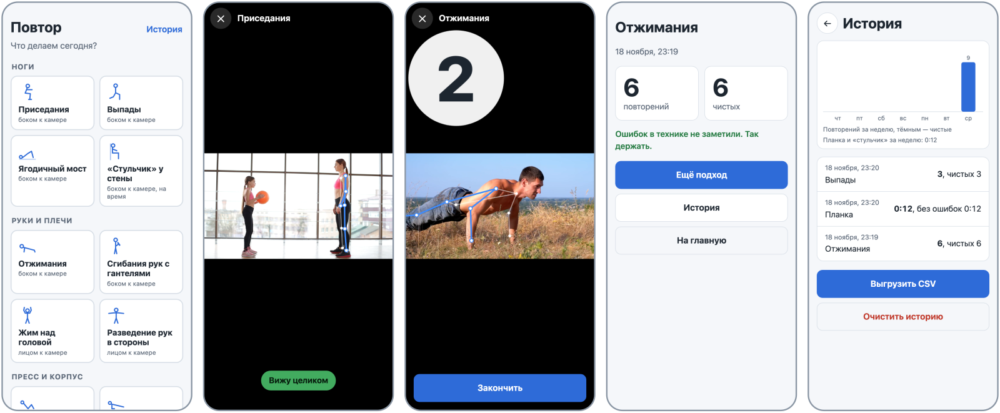
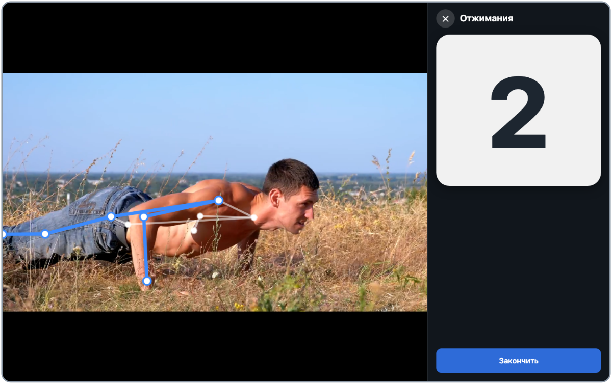
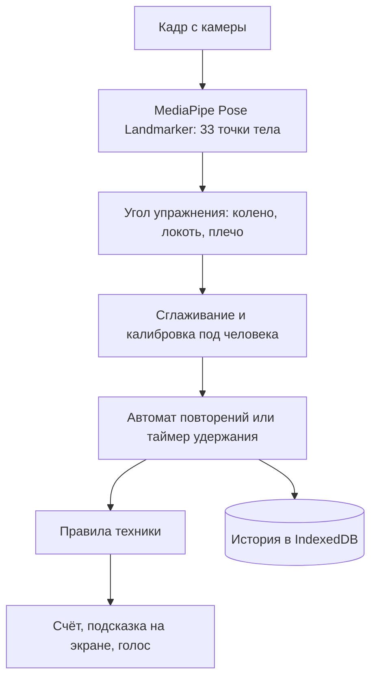

<p align="center">
  
</p>

<h1 align="center">Повтор</h1>

<p align="center">
  Считает повторения по камере телефона или ноутбука и подсказывает по технике.<br>
  Работает в браузере: ничего не нужно устанавливать, видео не записывается и никуда не уходит.
</p>

<p align="center">
  <a href="https://porphyras.github.io/povtor/"><b>Открыть приложение</b></a>
  &nbsp;·&nbsp;
  <a href="#как-это-работает">Как это работает</a>
  &nbsp;·&nbsp;
  <a href="#разработка">Разработка</a>
</p>

<p align="center">
  <a href="https://github.com/porphyras/povtor/actions/workflows/deploy.yml"></a>
</p>

<p align="center">
  
</p>

## Что умеет

- **Считает 10 упражнений.** Повторения — числом, планку и «стульчик» — временем в позе.
- **Подсказывает по технике** на экране и голосом: «Ниже», «Таз провисает», «Не раскачивайся». Повторение без подсказок считается чистым.
- **Помогает встать перед камерой.** Пока человек не в кадре или стоит не тем боком, приложение говорит, что исправить, и начинает отсчёт, только когда видит его целиком.
- **Ведёт историю** на устройстве: график за неделю, список подходов, выгрузка в CSV для Excel.
- **Подстраивается под экран.** На телефоне счёт лежит поверх видео, на компьютере и на повёрнутом телефоне видео слева, а крупный счёт и подсказки — в панели справа.

<p align="center">
  
</p>

## Упражнения

| Группа | Упражнение | Как встать | Что подсказывает |
|---|---|---|---|
| Ноги | Приседания | боком | «Ниже», «Наклон вперёд» |
| | Выпады | боком | «Ниже», «Корпус ровнее» |
| | Ягодичный мост | лёжа, боком | «Таз выше» |
| | «Стульчик» у стены, на время | боком | «Ниже, бёдра параллельно полу» |
| Руки и плечи | Отжимания | боком | «Таз провисает», «Таз задран», «Ниже» |
| | Сгибания рук с гантелями | боком | «Не раскачивайся», «Локоть прижми к корпусу» |
| | Жим над головой | лицом | «Выпрями руки до конца» |
| | Разведение рук в стороны | лицом | «Выше, до уровня плеч», «Не выше плеч» |
| Пресс и корпус | Скручивания | лёжа, боком | «Оторви лопатки от пола» |
| | Планка, на время | боком | «Таз провисает», «Таз задран» |

Телефон ставится экраном к себе на стул, стол или пол в 2–3 метрах, чтобы камера видела человека с головы до ног. Подробно — в пользовательской инструкции.

## Как это работает



1. Модель MediaPipe Pose Landmarker находит на каждом кадре 33 точки тела. Она работает прямо в браузере через WebAssembly, на видеокарте или, если та недоступна, на процессоре.
2. Для каждого упражнения берётся свой угол: в колене для приседаний, в локте для отжиманий, между корпусом и рукой для разведений. Угол сглаживается, а исходное положение запоминается под конкретного человека.
3. Повторение засчитывается, когда угол проходит путь «исходное положение → крайняя точка → обратно». Короткие рывки, частичные движения и чужие упражнения отсекаются: для выпада нужен шаг, для отжимания — упор на руки.
4. В крайней точке проверяются правила техники. Пороги и тексты подсказок собраны в одном файле [`src/config.json`](src/config.json).

## Приватность

- Кадры обрабатываются на устройстве и сразу забываются. Видео не записывается.
- Строгая политика безопасности страницы (Content-Security-Policy) разрешает загружать и отправлять данные только на сайт приложения. Чужие скрипты, картинки и запросы к другим сайтам браузер блокирует.
- Модель и WebAssembly лежат в самом приложении, внешних CDN нет. MediaPipe закреплён на версии 0.10.35: начиная с 1.x библиотека отправляет метрики в Google.
- Голосовые подсказки синтезируются голосом, установленным на устройстве. Сетевые голоса не используются, текст подсказок никуда не уходит.
- В истории хранятся только числа: дата, упражнение, сколько повторений и какие ошибки. Хранятся они в браузере пользователя.

«Повтор» не ставит диагнозов и не заменяет врача или тренера: подсказки касаются только формы движения.

## Проверка

| Что | Объём | Где |
|---|---|---|
| Синтетические позы, CSV, проверка данных, записи роликов на 15, 7,5 и 5 кадрах/с | 93 теста | [`tests/`](tests) |
| Корпус реальных роликов: точки тела и эталон по каждому ролику | 106 роликов по всем упражнениям, проходит 100 | [`tests/corpus/`](tests/corpus) |
| Прогон приложения в браузере по видеофайлам | 11 роликов | [`e2e/run.mjs`](e2e/run.mjs) |
| Сбои: отказ в камере, зависшая загрузка, «назад» и перезагрузка посреди подхода | 12 сценариев | [`e2e/break.mjs`](e2e/break.mjs) |
| Собранная версия: модель, камера, история, ни одного запроса к другим сайтам | перед каждой публикацией | [`e2e/smoke.mjs`](e2e/smoke.mjs) |

Корпус собран из стоковых роликов Mixkit, Pexels и Wikimedia Commons: 16 правильных, 54 сложных (двое в кадре, темнота, силуэты, склейки) и 36 негативных (не тот ракурс, другое упражнение). Самих видео в репозитории нет, только записанные с них точки. Они переигрываются при каждом `npm test`, поэтому правка порогов, которая ломает реальные ролики, на сайт не попадёт. Шесть известных провалов перечислены в [`tests/corpus.test.ts`](tests/corpus.test.ts) вместе с причинами.

## Разработка

Нужен Node.js 22.12 или новее.

```bash
npm install
npm run dev     # http://127.0.0.1:5173
npm test
```

Камера в браузере работает только на `localhost` или по HTTPS. На телефоне удобнее проверять опубликованную версию: по адресу вида `http://192.168…` браузер камеру не даст.

| Команда | Что делает |
|---|---|
| `npm run dev` | сервер разработки |
| `npm test` | все тесты, включая переигровку корпуса |
| `npm run build` | проверка типов и сборка в `dist/` |
| `npm run smoke` | проверка собранной версии в браузере (после `npm run build`) |
| `npm run e2e` | прогон приложения по видео из `test-videos/`, `-- --browser=webkit` — на движке Safari |
| `node e2e/break.mjs` | сценарии сбоев |
| `node e2e/camera.mjs` | полный путь через тестовую камеру Chrome: подготовка, счёт, итог, история, CSV |
| `node e2e/corpus.mjs --jobs=2` | прогон корпуса в браузере (ролики по ссылкам из [`tests/corpus/SOURCES.txt`](tests/corpus/SOURCES.txt) нужно скачать в `test-videos/corpus/`) |
| `npm run screens`, `npm run screens:wide` | скриншоты экранов телефона и широкого экрана |

<details>
<summary><b>Устройство проекта</b></summary>

```
src/
  analyzer/geometry.ts   углы, наклоны, перевод точек в пиксели
  analyzer/exercises.ts  описания упражнений: какой угол считать, как проверять положение, правила техники
  analyzer/analyzer.ts   общий движок: сглаживание, калибровка, автомат повторений, удержание по времени
  catalog.ts             названия, группы, значки и подсказки упражнений
  config.json            пороги и тексты подсказок
  pose.ts                загрузка модели и WebAssembly с повтором, прогрев, распознавание
  camera.ts              камера и режим видеофайла
  storage.ts, history.ts история в IndexedDB, проверка данных, CSV, статистика по дням
  voice.ts               голосовые подсказки (Web Speech API)
  ui/                    экраны: главная, подход, итог, история
tests/                   тесты, генератор синтетических поз, записи роликов, корпус
e2e/                     прогоны в настоящем браузере (Playwright)
```

Стек: Vite и TypeScript без фреймворков, [MediaPipe Tasks Vision](https://ai.google.dev/edge/mediapipe/solutions/vision/pose_landmarker), [idb](https://github.com/jakearchibald/idb), Vitest, Playwright.

Упражнения «вверх» (мост, жим, разведения, скручивания) движок переводит в сигнал `360 − угол`, поэтому автомат повторений один для всех.

</details>

<details>
<summary><b>Как поменять пороги или добавить упражнение</b></summary>

Пороги меняются в [`src/config.json`](src/config.json). После изменения повысьте `version`: она сохраняется вместе с каждым подходом. Затем `npm test` покажет, как правка повлияла на 106 реальных роликов.

Новое упражнение:

1. Добавить его код в тип `Exercise` и коды ошибок в `ErrorCode` (`src/types.ts`).
2. Описать в `SPECS` (`src/analyzer/exercises.ts`): какие точки нужны, какой угол считаем, как проверяем положение, какие правила техники.
3. Добавить пороги и тексты подсказок в `src/config.json`, проверку полей — в `src/config.ts`.
4. Добавить карточку в `CATALOG` (`src/catalog.ts`): название, группа, значок, подсказки.
5. Написать тест на синтетических позах в `tests/exercises.test.ts` и по возможности добавить ролики в корпус.

</details>

<details>
<summary><b>Режим проверки по видеофайлу</b></summary>

На сервере разработки параметры адреса действуют всегда, на сайте — только вместе с `?dev`.

| Параметр | Что делает |
|---|---|
| `?dev` | панель отладки: фаза, автомат, угол, пороги, кадры в секунду |
| `&video=/test-videos/x.mp4` | видеофайл с этого же сайта вместо камеры |
| `&step=15` | покадровый проход файла с частотой 15 кадров/с: результат не зависит от скорости компьютера |
| `&delegate=CPU`, `&model=lite` | принудительно процессор или облегчённая модель |
| `&record` | сохранять точки тела в `window.__povtor.frames` |
| `&countdown=0`, `&ready=200` | без отсчёта, короткая подготовка |

Пример: `http://127.0.0.1:5173/?dev&step=15&video=/test-videos/pushup_side.mp4#/session/pushup`.

Запись точек можно прогнать через движок с печатью сигнала по кадрам:

```bash
REPLAY=e2e/out/pushup_side.chromium.frames.json EX=pushup npx vitest run tests/replay.debug.test.ts --reporter=verbose
```

</details>

<details>
<summary><b>Публикация</b></summary>

При пуше в `main` GitHub Actions ([`.github/workflows/deploy.yml`](.github/workflows/deploy.yml)) запускает тесты, собирает приложение, проверяет сборку в браузере и публикует её на GitHub Pages. Если любой шаг не прошёл, сайт остаётся прежним.

</details>

## Команда

Колосов Егор и Смагулов Руслан. Итоговый проект курса «Проектная деятельность», осень 2026.

## Лицензии и источники

- MediaPipe Tasks Vision — Apache 2.0. Модели Pose Landmarker — Google, условия в [карточке модели](https://ai.google.dev/edge/mediapipe/solutions/vision/pose_landmarker#models).
- idb — ISC.
- Точки тела для тестов записаны со стоковых роликов Mixkit (Mixkit Stock Video Free License), Pexels (Pexels License) и Wikimedia Commons (свободные лицензии, указаны у каждого файла). Ссылки — в [`tests/fixtures/SOURCES.txt`](tests/fixtures/SOURCES.txt) и [`tests/corpus/SOURCES.txt`](tests/corpus/SOURCES.txt).
